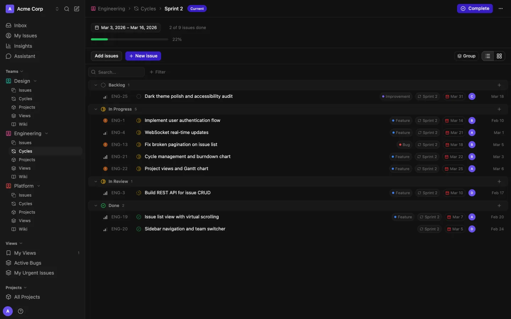
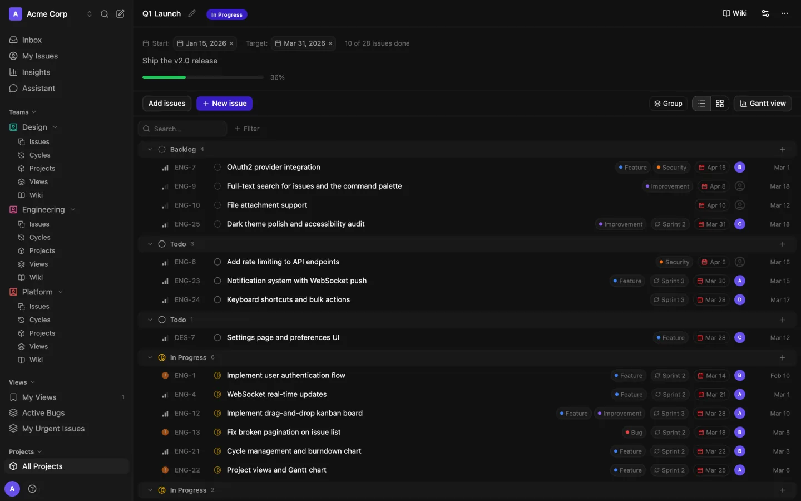
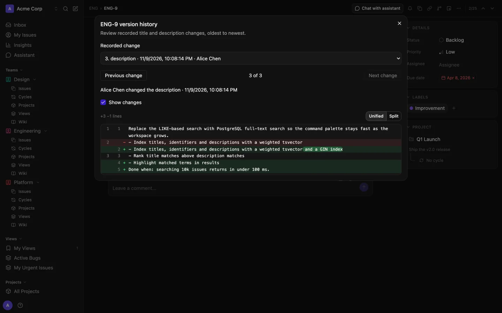
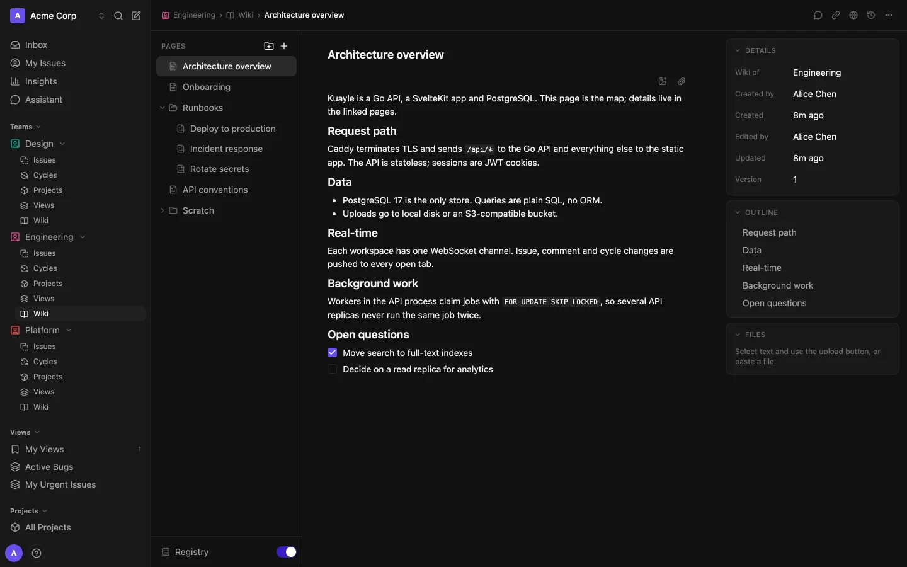
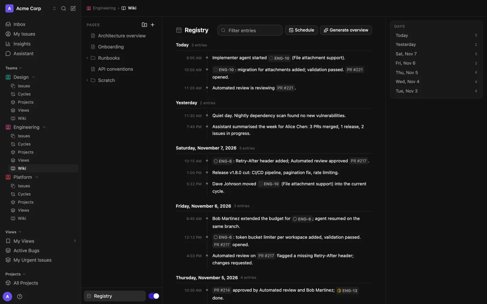
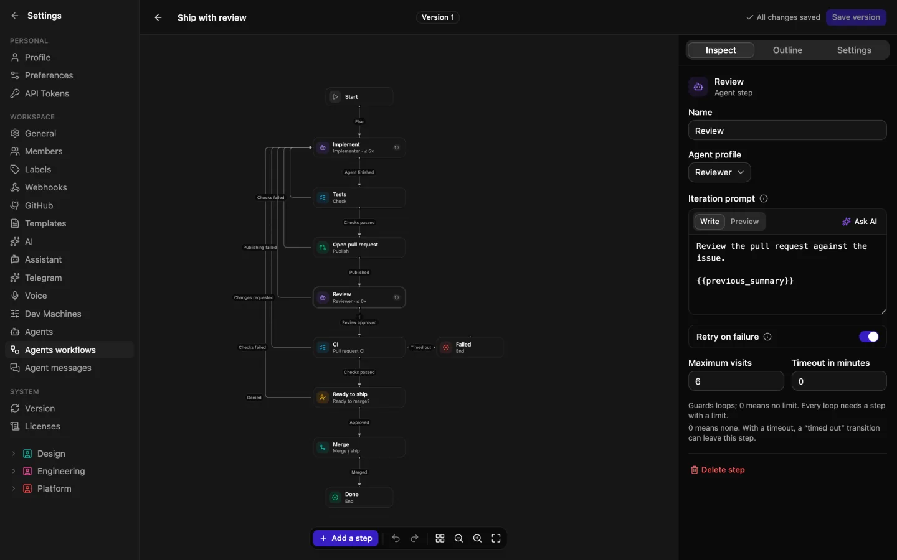

<div align="center">
  
  <p><strong>快乐 (kuàilè) · happiness, joy</strong></p>
	<p><strong>The issue tracker with no paid tier.</strong></p>
	<p>Keyboard-driven, self-hosted, and available in one public Apache 2.0 repository.</p>

[](https://github.com/carbogninalberto/kuayle/releases/latest)
[](LICENSE)
[](https://github.com/sponsors/carbogninalberto)

[Features](#highlights) · [Screenshots](#feature-tour) · [Quick start](#quick-start) · [Self-hosting](#self-hosting) · [Docs](docs/README.md) · [Sponsor](https://github.com/sponsors/carbogninalberto)

[Report Bug](https://github.com/carbogninalberto/kuayle/issues/new?labels=bug) · [Request Feature](https://github.com/carbogninalberto/kuayle/issues/new?labels=enhancement)

</div>

<br />

[](https://kuayle.com)

## Contributors

Thanks to everyone who has contributed code, reviews and ideas. See the
[contributors graph](https://github.com/carbogninalberto/kuayle/graphs/contributors).

<!-- contributors:start -->
<a href="https://github.com/carbogninalberto"></a>
<a href="https://github.com/carbninai"></a>
<a href="https://github.com/uiYzzi"></a>
<a href="https://github.com/kasperhartwich"></a>
<a href="https://github.com/MarioGK"></a>
<a href="https://github.com/manelpb"></a>
<!-- contributors:end -->

## What is Kuayle

Kuayle is an open-source issue tracker you run on your own server. It is fast and
keyboard-driven, covers issues, cycles, projects and wikis, and comes with an AI
assistant that can hand issues to coding agents running on your own machines.

## Highlights

<table>
<tr>
<td width="33%" valign="top">⌨️ <b>Keyboard-first issues</b><br>Command palette, shortcuts, multiple assignees, sub-issues and relations.</td>
<td width="33%" valign="top">🔄 <b>Cycles and projects</b><br>Sprints with burndown and velocity; cross-team projects with a Gantt view.</td>
<td width="33%" valign="top">💬 <b>AI assistant</b><br>Finds, files and plans issues and wiki pages; risky actions wait for your approval.</td>
</tr>
<tr>
<td width="33%" valign="top">🤖 <b>Coding agents on your machines</b><br>Hand an issue to Claude Code, Codex, OpenCode and others on self-hosted Dev Machines.</td>
<td width="33%" valign="top">🧭 <b>Agent workflows</b><br>Design the steps an agent task follows: implement, test, review, CI and merge.</td>
<td width="33%" valign="top">📖 <b>Wiki and daily registry</b><br>Team and project pages with history, publishing and AI overviews of each day.</td>
</tr>
<tr>
<td width="33%" valign="top">🏠 <b>Self-hosted, no paid tier</b><br>One Apache 2.0 repository. No license keys, no per-user fees.</td>
<td width="33%" valign="top">⚡ <b>Real-time and public links</b><br>Changes reach every open tab; share read-only links to issues and views.</td>
<td width="33%" valign="top">🌐 <b>Four languages</b><br>English, Italian, and Simplified and Traditional Chinese.</td>
</tr>
</table>

## Feature tour

Screenshots from a local instance with the repository's seed data. The cycle,
project and history images are the same files [kuayle.com](https://kuayle.com) uses.

<table>
<tr>
<td width="58%"></td>
<td width="42%"><h3>Cycles</h3><ul><li>Time-boxed sprints with progress, burndown and velocity.</li><li>The same list and board layouts as the issue list.</li><li>Add issues from the whole team, or create one already in the cycle.</li></ul></td>
</tr>
<tr>
<td width="42%"><h3>Projects</h3><ul><li>Group work across teams under one project.</li><li>Status, lead, start and target dates, and progress.</li><li>List, board or Gantt view of the same issues.</li></ul></td>
<td width="58%"></td>
</tr>
<tr>
<td width="58%"></td>
<td width="42%"><h3>Version history</h3><ul><li>Every title and description edit, with author and time.</li><li>Unified or split diff, or the full before and after values.</li><li>Captured in the same transaction as the edit.</li></ul></td>
</tr>
<tr>
<td width="42%"><h3>Team and project wikis</h3><ul><li>Pages and folders in a tree you can drag to reorder.</li><li>Autosave, outline, attachments and AI rework of a selection.</li><li>History with diffs and restore.</li><li>Publish a page to an internal reader or a public link.</li></ul></td>
<td width="58%"></td>
</tr>
<tr>
<td width="58%"></td>
<td width="42%"><h3>Daily registry</h3><ul><li>A day-by-day log that people and agent tasks append to.</li><li>Filter entries and jump between days.</li><li>AI overviews on demand or on a daily or weekly schedule.</li></ul></td>
</tr>
<tr>
<td width="42%"><h3>Agent workflows</h3><ul><li>Draw the steps a coding task follows, with loops and limits.</li><li>Templates: Standard, Review loop, Full cycle, or blank.</li><li>Agent profiles with a model, instructions and skills.</li><li>Defaults per workspace, team or project.</li></ul></td>
<td width="58%"></td>
</tr>
</table>

## All features

<details>
<summary><b>Issues and planning</b></summary>

- Workspaces with owner, admin, member and guest roles; teams with their own statuses and triage; private teams.
- Issues with priority, due dates, multiple assignees, hierarchical labels, sub-issues, relations (blocking, duplicate, related), comments, templates and a title/description version history shown as diffs.
- Cycles with burndown and velocity charts; cross-team projects with a Gantt view.
- Saved views (personal, team or workspace), favorites, a notification inbox (read state, snooze, archive), a command palette with global search, keyboard shortcuts, and a Tiptap editor with code blocks, slash commands, mentions, task lists and file uploads.
- Analytics: workspace and team overviews, burn-up trends, configurable insights.
- Real-time updates and presence over WebSockets; read-only public links for issues and views.
- UI in English, Italian, and Simplified and Traditional Chinese.

</details>

<details>
<summary><b>AI assistant</b></summary>

- Workspace chat backed by any OpenAI-compatible provider you configure.
- Tools to search, create, update, plan and link issues, read and edit wiki pages, delegate issues to coding agents, and follow pull requests and releases.
- Risky actions (delegating, merging, releases, deletions, custom tools) wait for your approval and are re-checked against your role when approved.
- Read-only research: web search (Brave, Tavily or self-hosted SearXNG) and repository scans.
- Workspace and team skills (Markdown guidance) and custom script tools.
- The same assistant on Telegram, and voice dictation transcribed on your server.

</details>

<details>
<summary><b>Agents and Dev Machines (opt-in, disabled by default)</b></summary>

- Multi-container dev machines with code-server, a native terminal and an in-browser Chrome, behind an authenticated gateway, with one Git worktree per issue.
- Coding agents: Claude Code, Codex, OpenCode, Qwen Code, Crush, Goose and Kimi, plus admin-configured CLIs.
- Delegated tasks run an independent check, open a pull request, and pick up CI failures and review feedback. Blocked issues wait for their blockers.
- Automations start agents on issues matching a label or status.

</details>

<details>
<summary><b>Agent workflows (Settings → Agents workflows)</b></summary>

- A visual editor to design the steps a coding task follows: implement, test, open a pull request, agent review, CI, your go-ahead and merge. Start from templates (Standard, Review loop, Full cycle) or a blank workflow.
- Defaults per workspace, team or project; the most specific one wins.
- Agent profiles: a role, coding agent, model and instructions, plus skills from the workspace library delivered as <code>SKILL.md</code> files. Profiles never grant permissions; every step runs under the workspace policy.

</details>

<details>
<summary><b>Wiki and registry</b></summary>

- Team and project wikis: pages in a folder tree, autosave, AI rework of a selection, and version history with diffs and restore.
- Publish a page (and optionally its children) to an internal reader or a public link.
- A daily registry log, with AI overviews on demand or on a daily/weekly schedule.

</details>

<details>
<summary><b>Integrations</b></summary>

- GitHub App: links branches, commits and pull requests to issues, moves issues through configurable status rules, and comments on pull requests.
- Outgoing webhooks, personal access tokens with scopes, and Telegram.
- Workspace export/import between instances, with assets and ID remapping.

</details>

<details>
<summary><b>Self-hosting</b></summary>

- Reference Docker Compose stack: Caddy, PostgreSQL, Redis, backend and frontend.
- Update script, optional one-click updater from Settings → Version, a release-image updater, and an in-app release changelog.
- Optional voice transcription, SearXNG web search and S3-compatible storage.

</details>

## Why Kuayle

It started with a narrow requirement: keep a fast, keyboard-oriented issue
workflow, and add multiple assignees, self-hosting and full source access.

- One public repository under Apache 2.0.
- No paid tier, enterprise edition, feature gate or license key.
- No per-user software fee.
- Infrastructure, backups, monitoring and updates are the operator's job.

Kuayle is intentionally smaller than broad project-management suites. It does not
include enterprise identity (SSO) or modules.

## Current state

Releases are runnable MVPs, not a mature enterprise platform. The repository has
the Go API, the SvelteKit frontend, migrations, development tooling and a
reference self-hosting setup. Evaluate and test it against your requirements
before production use.

## Quick start

**Docker** (everything in containers):

```sh
cp .env.example .env
make docker-up
```

App at `http://localhost:5173`, API at `http://localhost:8080`.

**Local development** (backend and Vite on the host, services in Docker):

```sh
cp .env.example .env
make reset-dev
make seed
make dev-start-services
make dev
```

See [development](docs/development.md) for all `make` commands, the tech stack and
the project layout.

## Self-hosting

The reference stack lives in [`selfhosting/`](selfhosting/). You need a Linux
server with Docker Compose v2 and a domain; Caddy handles HTTPS. Clone, fill in
`selfhosting/.env`, run `docker compose up --build -d`, then apply migrations.

The [self-hosting guide](docs/self-hosting.md) covers install, updates, storage,
Dev Machines, voice, web search, private teams and workspace transfer. GitHub
setup is in [GitHub integration](docs/github-integration.md). All docs are
indexed in [docs/](docs/README.md).

## Community and ecosystem

- [kuayle_cli](https://github.com/uiYzzi/kuayle_cli) by [@uiYzzi](https://github.com/uiYzzi):
  an unofficial Rust CLI and SDK for using Kuayle from the terminal, by people or
  coding agents.

## Contributing

Pull requests are welcome. Keep changes focused, explain the behavior you change
and include relevant validation: fork, branch, commit, open a PR.

## Sponsoring

If Kuayle is useful to you, you can support it through
[GitHub Sponsors](https://github.com/sponsors/carbogninalberto).

## License

Apache 2.0, see [`LICENSE`](LICENSE).

## Contact

Alberto Carbognin, [@carbogninalberto](https://github.com/carbogninalberto)

---

> **Project note:** Kuayle has been developed with AI-assisted tooling under human
> direction and review.
